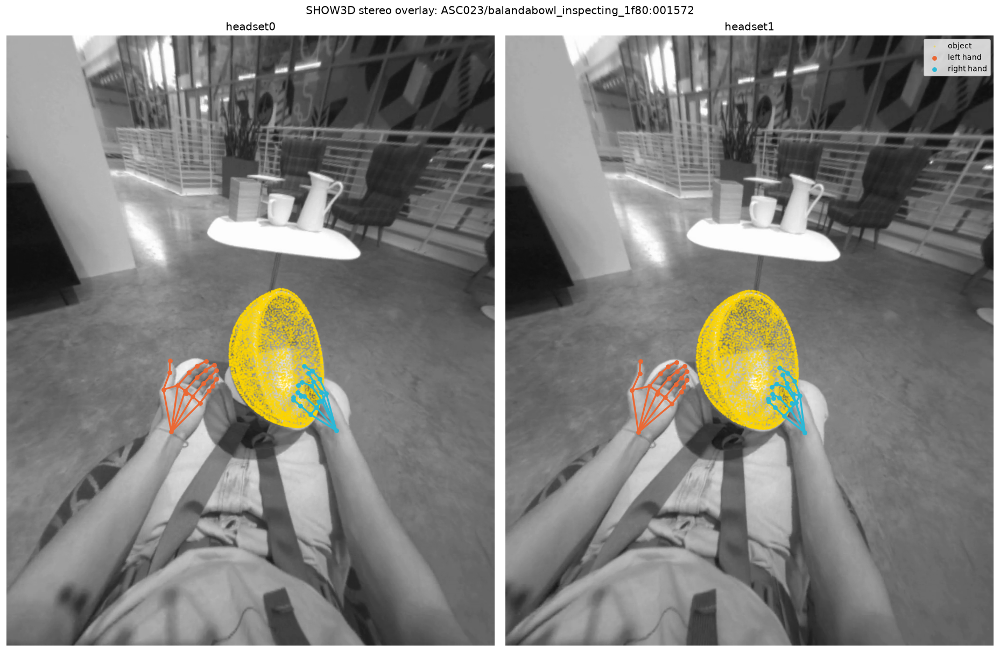
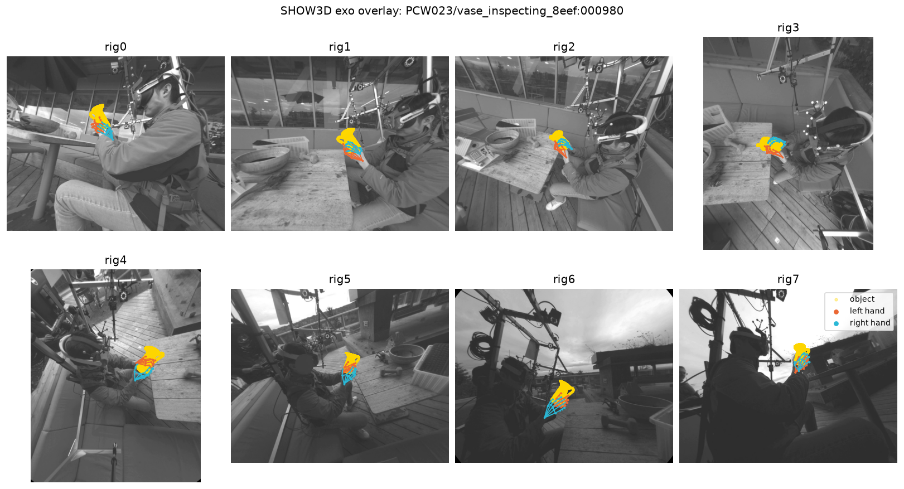
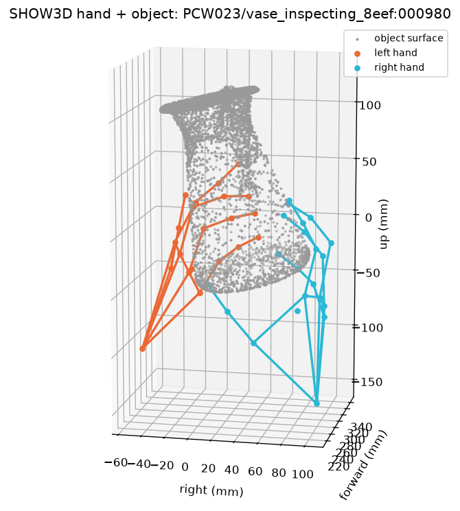
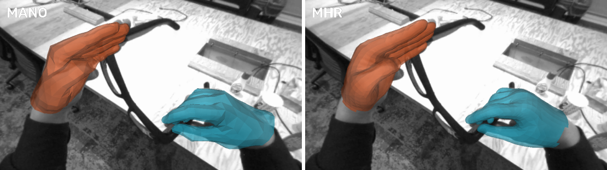
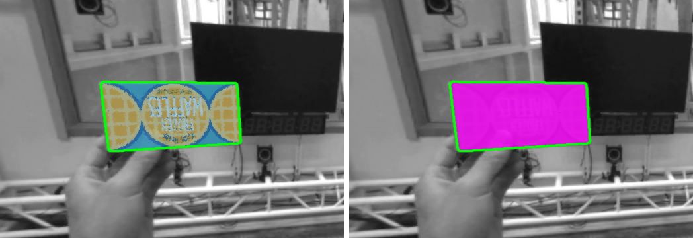

# SHOW3D

Python tools for [SHOW3D](https://huggingface.co/datasets/facebook/show3d-dataset),
a dataset of 3D hands and objects captured in the wild (CVPR 2026).

[Paper](https://arxiv.org/abs/2603.28760) |
[Dataset](https://huggingface.co/datasets/facebook/show3d-dataset)



SHOW3D has 2,137 recordings of hands using objects in the wild, 20 hours in
total. Each recording has two egocentric views from a Meta Quest 3 headset at 60
fps, and up to eight exocentric views from a camera rig worn on the back. The
training scenes come with marker-less 3D hand poses, and a subset of them with
object poses too; `object_pose/v2/index.parquet` lists them. From hand_pose v3
on, the test scenes come with hand poses too, and from object_pose v2 on, a
subset of them with object poses.

With this package you can:

- load frames: video paths, camera calibration, hand poses and object poses
- draw hands and objects on a frame, or in 3D
- pose and draw hand meshes in three hand models: UmeTrack, MANO and MHR
- draw object meshes on a frame, posed by the object poses
- extract frames to images for fast training

The package covers all ten cameras: the two headset cameras and the eight rig
cameras. The dataset card describes the captions.

## Install

```bash
git clone https://github.com/facebookresearch/show3d.git
cd show3d
pip install -r requirements.txt
```

The core needs only numpy and OpenCV. Drawing needs matplotlib. Hand meshes need
a few more packages; see [Render hand meshes](#render-hand-meshes).

## Try it without the data

This command draws a small synthetic scene, so you can check your install before
you download anything:

```bash
python -m show3d.demo_viz --out geometry.png
```

## Get the data

Download SHOW3D from Hugging Face:
[`facebook/show3d-dataset`](https://huggingface.co/datasets/facebook/show3d-dataset).
The code expects the released layout under one root folder:

```
<root>/
├── scenes/<subject>/<scene>/
│   ├── headset0.mp4, headset1.mp4              # egocentric videos
│   ├── rig0.mp4 ... rig7.mp4                   # exocentric videos
│   ├── camera_calibration/headset{0,1}.json   # intrinsics + per-frame pose
│   ├── camera_calibration/rig{0..7}.json      # intrinsics + one static pose
│   └── metadata/frame_info.json
├── object_pose/
│   ├── <version>/scenes/<subject>/<scene>/object_pose.json
│   └── <version>/test_scenes/<subject>/<scene>/  # v2 on: the test split, same file
└── hand_pose/
    ├── <version>/scenes/<subject>/<scene>/hand_pose_umetrack.json   # v1, v2: hand_pose.json
    ├── <version>/test_scenes/<subject>/<scene>/  # v3 on: the test split, same files
    └── hand_profiles/<subject>/profile_umetrack.json
```

From hand_pose v3 on, each scene also has `hand_pose_mano.json` and
`hand_pose_mhr.json`, and each subject has `profile_mano.json` and
`profile_mhr.json`.

The test split's hand poses are in `hand_pose/<version>/test_scenes/` from v3
on, and its object poses are in `object_pose/<version>/test_scenes/` from v2 on.
The loaders pick the folder from the subject ID, and `TEST_SUBJECTS` in
`show3d.dataset` lists the test subjects. `Show3DPaths` and `Show3DDataset` read
object_pose v2 and hand_pose v2 by default, so pass `hand_pose_version="v3"` for
the test split's hand poses.

A scene ID has the form `<object>_<action>_<hash>`, for example
`bbq_cleaning-the-outside_277b`. The part before the first underscore names the
object.

## Load frames

`Show3DDataset` takes a root folder and a list of frames. Each item holds one
frame's video paths, calibration, hand poses and object pose. `posed_frames`
lists the frames of a recording that have an object pose:

```python
from show3d.dataset import posed_frames, Show3DDataset

root = "/path/to/show3d"
frames = posed_frames(root, "ISH822", "aria_inspecting_3ab0")[::30]
dataset = Show3DDataset(root, frames)

frame = dataset[0]
frame.left_hand           # confidence and (21, 3) landmarks_world_mm, or None
frame.object_pose         # confidence, rotation and translation_mm, or None
frame.views["headset0"]   # video_path and calibration (intrinsics, world-from-camera)
```

The dataset loads the two headset cameras by default. Pass
`views=CAMERA_VIEWS` (from `show3d.dataset`) for all ten cameras, or
`views=EXOCENTRIC_VIEWS` for the eight rig cameras `rig0` to `rig7`. A rig camera
has one fixed pose in the rig frame, so it is valid on every frame. A scene can
lack some rig cameras, and `frame.views[name].missing` is true when
`metadata/frame_info.json` lists that camera as missing on the frame.

Positions are in millimeters, in the world frame of the scene's calibration. This
world frame is the frame of the back-mounted rig, so it moves with the person. See
the dataset card for details.

The loader reads hand_pose v2 and object_pose v2 by default. Pass
`hand_pose_version` or `object_pose_version` to pick another release. It returns
paths only. Pass `decode_images=True` to also decode each frame with OpenCV.

Take a recording's object pose frames from its object_pose file, whose keys give
the frames it labels. A v1 file has an entry on every video frame. A v2 file has
an entry on every other video frame, from frame 0 or from frame 1, or on every
video frame; in a few v2 files the grid shifts by one frame at one or more
points. A fixed stride from frame 0 can therefore miss all of a recording's
poses. `posed_frames` reads the file's keys and keeps the frames whose entry has
a pose, so it follows each file's grid. Pass `min_confidence` to keep only the
poses above that confidence.

You can also list frames yourself, as `Show3DFrameRef(subject_id, scene_id,
frame_index)`, or keep them in a manifest: a JSONL file with one
`{"subject_id", "scene_id", "frame_index"}` object per line. Load it with
`Show3DDataset.from_manifest_jsonl(root, path)`, and write one with
`write_frame_manifest_jsonl`.

### Headset pose validity

Use a frame's headset pose only when `frame.headset_pose_valid` is true.

- **Calibration files with `pose_contract_version` 1** carry `is_pose_valid` and
  `pose_source` (`mocap`, `vio`, `endpoint_interpolation`,
  `smooth_mocap_interpolation` or `legacy_unspecified`) per frame. The loader
  returns `t_world_from_camera` only when `is_pose_valid` is true.
- **Older calibration files** have only `is_synthesized`, which is true when
  interpolation produced the pose. The loader returns `t_world_from_camera` only
  when `is_synthesized` is false.

Pin the data and code revisions together to keep the same set of valid frames.

## Visualize a frame

`show3d.demo_viz` draws one frame of a manifest:

```bash
python -m show3d.demo_viz --root /path/to/show3d --manifest frames.jsonl \
    --mode overlay --view stereo --out overlay.png
python -m show3d.demo_viz --root /path/to/show3d --manifest frames.jsonl \
    --mode overlay --view exo --out exo.png
python -m show3d.demo_viz --root /path/to/show3d --manifest frames.jsonl \
    --mode geometry --out geometry.png
```

It picks the first frame with a camera pose in every view it draws and a
confident hand. The `overlay` mode projects the hand skeletons and object onto
one camera's image (`--view headset0`, `headset1` or `rig0` to `rig7`), onto
both headset images side by side with `--view stereo`, as in the image at the
top, or onto every rig camera with a pose with `--view exo`:



Left hands are orange and right hands cyan in every render, hand meshes
included. The `geometry` mode draws them in 3D, in the headset0 camera's frame
and seen from near that camera, so it lines up with the headset image:



The object comes from object_pose v2, and `--object-pose-version v1` draws v1.
Write the manifest from `posed_frames`, so that the frames have an object pose.
The drawing functions live in `show3d.viz` and the camera projection in
`show3d.camera`.

## Render hand meshes

From hand_pose v3 on, every hand-frame with world geometry comes in three hand
models: UmeTrack (the native solve), MANO and MHR. `show3d.hand_mesh` poses each
of them in the scene's world frame, and `demo_viz --model` draws the meshes on
one camera's frame (`--view`, headset0 by default), or on a frame range with
`--video`:

```bash
python -m show3d.demo_viz --root /path/to/show3d --scene ISH822/aria_inspecting_3ab0 \
    --model umetrack --frame 600 --out umetrack.png
python -m show3d.demo_viz --root /path/to/show3d --scene ISH822/aria_inspecting_3ab0 \
    --model mano --asset-dir /path/to/mano/models --frame 600 --out mano.png
python -m show3d.demo_viz --root /path/to/show3d --scene ISH822/aria_inspecting_3ab0 \
    --model mhr --asset-dir /path/to/mhr/assets --video --num-frames 300 --out mhr.mp4
```

Frame 600 of that scene, cropped to the hands, in MANO and MHR (left hand
orange, right hand cyan):



Each model needs its own packages and files, which `requirements.txt` leaves
out. pymomentum-cpu needs Python 3.12 or 3.13.

- **UmeTrack:** `pip install torch projectaria-tools`, and put the `hot3d/`
  folder of [HOT3D](https://github.com/facebookresearch/hot3d) on `PYTHONPATH`.
  HOT3D's UmeTrack loader poses the mesh. hand_pose v2 works too, with
  `--hand-pose-version v2`.
- **MANO:** `pip install torch smplx`, with `MANO_LEFT.pkl` and `MANO_RIGHT.pkl`
  from [MANO](https://mano.is.tue.mpg.de) in the `--asset-dir` folder. smplx
  loads them without chumpy only after their chumpy objects are removed with
  smplx's `tools/clean_ch.py`, which runs under Python 2 with chumpy installed.
- **MHR:** `pip install torch mhr pymomentum-cpu`, with the asset folder of
  [MHR](https://github.com/facebookresearch/MHR) as `--asset-dir`.

The same meshes from Python, as world-frame vertices in mm with their faces:

```python
from show3d.hand_mesh import HandMeshScene, RIGHT_SLOT

scene = HandMeshScene("/path/to/show3d", "ISH822", "aria_inspecting_3ab0", "mano",
                      asset_dir="/path/to/mano/models")
mesh = scene.mesh(600, RIGHT_SLOT)
```

`mesh` is None when the hand is missing, its confidence is 0.1 (the accept gate)
or lower, or, for UmeTrack, the frame has no world geometry. Pass
`confidence_threshold=0.5` for the high-confidence gate.

## Render object meshes

The 22 objects that SHOW3D shares with [HOT3D](https://github.com/facebookresearch/hot3d)
come with their meshes, in `show3d/assets/objects/`: the BOP-HOT3D `models_eval`
models, in millimeters, in the object frame of the object poses, with no color.
`HOT3D_OBJECT_LID` in `show3d.dataset` lists them. The full models with their
color textures are in BOP-HOT3D's `hot3d_models.zip` on
[Hugging Face](https://huggingface.co/datasets/bop-benchmark/hot3d).
`show3d.hot3d_models` downloads that zip (137 MB) at a pinned revision, checks
its sha256 and keeps the 22 objects' models (44 files, 174 MB) in
`~/.cache/show3d/hot3d_models`, or under `$XDG_CACHE_HOME` when it is set.
Nothing is downloaded until you run it, and a second run that finds all 44 files
in the cache downloads nothing. `--zip` extracts a copy of the zip you already
have:

```bash
python -m show3d.hot3d_models
```

`demo_viz --object-mesh` draws a scene's object mesh, posed by its object pose,
on one camera's frame. It draws the color model when it is in the cache, and the
bundled mesh in magenta otherwise, so it also works offline. When it falls back,
it prints the cache path it searched and the command that fetches the color
model. Either way it outlines the object's silhouette in green:

```bash
python -m show3d.demo_viz --root /path/to/show3d --scene SCH724/waffles_tossing-between-hands_e22d \
    --object-mesh --frame 1201 --out waffles.png
python -m show3d.demo_viz --root /path/to/show3d --scene PRI519/whiteboardmarker_writing-paper_2a1d \
    --object-mesh --frame 601 --view rig1 --out marker_rig1.png
```

Without `--frame`, it draws the scene's first frame with an object pose.
`--hot3d-models-dir` points it at another cache folder. Frame 1201 of the
waffles scene, cropped, with the color model and with the bundled mesh:



The same from Python, on the decoded frame or any image of it:

```python
from show3d.dataset import load_object_mesh_with_faces, posed_frames, Show3DDataset
from show3d.hot3d_models import load_color_mesh
from show3d.viz import draw_object_mesh

root = "/path/to/show3d"
frames = posed_frames(root, "PRI519", "whiteboardmarker_writing-paper_2a1d")
frame = Show3DDataset(root, frames[:1], decode_images=True)[0]
view = frame.views["headset0"]
# vertices_mm and faces, plus face_colors for the color model
mesh = load_color_mesh("whiteboardmarker") or load_object_mesh_with_faces("whiteboardmarker")
image = draw_object_mesh(view.image, mesh, frame.object_pose, view.calibration)
```

Both loaders return None for the five objects that HOT3D does not have:
keyboard2, cancoke, windex, clock and mug3. `load_color_mesh` also returns None
until the model is in the cache. The largest color model takes a few seconds to
read, so load each model once.

## Extract frames for training

Seeking to random frames in an MP4 is slow, so training straight from the videos
spends most of its time decoding. `show3d.extract_images` decodes each video once,
keeps the frames at the rate you choose, and writes them as images:

```bash
python -m show3d.extract_images --root /path/to/show3d --out frames/ --fps 10
```

- `--fps` is required. It must divide the 60 fps source evenly: 1, 2, 3, 4, 5, 6,
  10, 12, 15, 20, 30 or 60.
- `--manifest` limits the run to the scenes a manifest names. Without it,
  `--require-object-pose` keeps only the scenes with object poses. From
  object_pose v2 on, those include the test subjects' scenes; `--subjects`
  restricts the run, and `TEST_SUBJECTS` in `show3d.dataset` lists the test
  subjects.
- `--posed-only` keeps only the frames with an object pose above confidence
  0.5, sampled on the frames that each recording's object_pose file labels:
  it keeps a labeled frame once it is the stride (60 / `--fps`) past the last
  one kept. For object_pose v1, which labels every frame, that is every
  stride-th frame from frame 0. A v2 file that labels every other frame,
  starting at frame 1, still gets its frames. On such a file an odd stride grows
  by one frame, so the rate rounds down to the grid: `--fps 20` gives 15 fps
  and `--fps 12` gives 10. A v2 run with such an `--fps` prints a one-line note.
  Without `--posed-only`, frames count from frame 0, so they can miss every label
  of such a v2 file.
- `--views headset0`, `--format png`, `--quality 80` and `--workers 16` set the
  cameras, image format, JPEG quality and parallelism. `--views` takes any of
  the ten cameras, for example `--views rig0 rig1`; the default is the two
  headsets.

The output has one image per frame and view, plus `index.jsonl` with one row per
image. Each row's `sample_id` (`SUBJECT/SCENE:FRAME`) is the same for every view
of a frame, so you can join per-frame labels to the images on it.

## Repository layout

```
show3d/
├── dataset.py            # dataset loader, paths and pose parsing
├── camera.py             # pinhole projection
├── viz.py                # drawing: skeletons, objects, hand and object meshes
├── demo_viz.py           # visualization command line
├── hand_mesh.py          # posed hand meshes; one hand_mesh_<model>.py per model
├── extract_images.py     # extract frames to images at a chosen fps
├── hot3d_models.py       # fetch and load the HOT3D color models
├── synthetic.py          # a tiny synthetic scene for demos and tests
├── assets/objects/       # object meshes (.glb, from HOT3D)
└── tests/                # unit tests
```

Run the tests with:

```bash
python -m unittest discover
```

## License

The code is released under Creative Commons Attribution-NonCommercial 4.0
International (CC BY-NC 4.0); see `LICENSE`.

The object meshes are HOT3D object models: the ones bundled in
`show3d/assets/objects/` (BOP-HOT3D `models_eval`) and the color models that
`show3d.hot3d_models` downloads (BOP-HOT3D `models`). They come under the terms
of the [HOT3D Dataset License Agreement](https://www.projectaria.com/datasets/hot3d/license/)
(also in [`bop-benchmark/hot3d`](https://huggingface.co/datasets/bop-benchmark/hot3d/blob/main/hot3d_dataset_license_agreement.pdf)),
which puts them under [CC BY-SA 4.0](https://creativecommons.org/licenses/by-sa/4.0/)
with one change: you may not sell them or put them into a product to be sold.
See `show3d/assets/objects/ATTRIBUTION.md`.

## Citation

If you use SHOW3D, please cite:

```bibtex
@InProceedings{Rim_2026_CVPR,
    author    = {Rim, Patrick and Harris, Kevin and Copple, Braden and Han, Shangchen and Xie, Xu and Shugurov, Ivan and An, Sizhe and Wen, He and Wong, Alex and Hodan, Tomas and He, Kun},
    title     = {SHOW3D: Capturing Scenes of 3D Hands and Objects in the Wild},
    booktitle = {Proceedings of the IEEE/CVF Conference on Computer Vision and Pattern Recognition (CVPR)},
    month     = {June},
    year      = {2026},
    pages     = {7111-7120}
}
```
